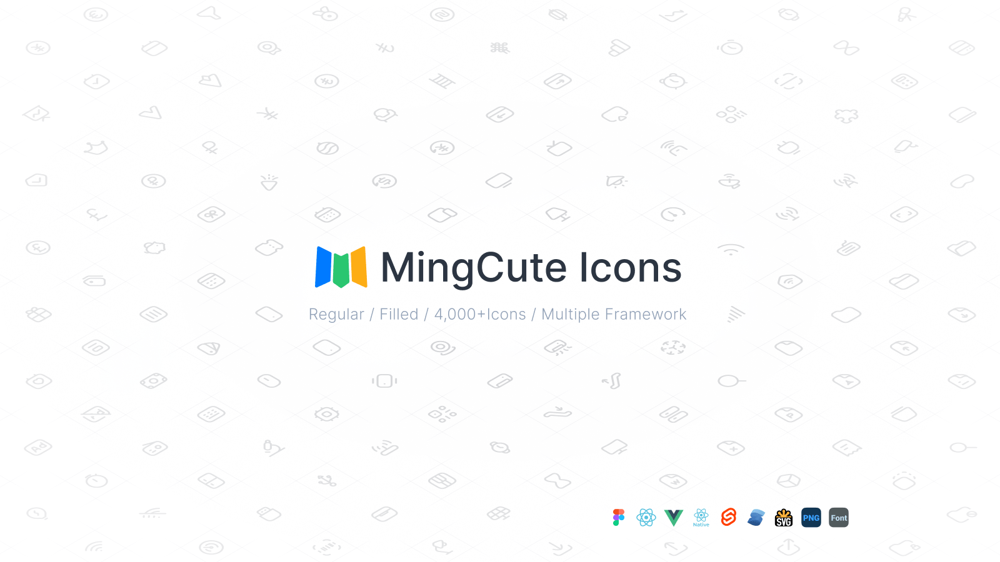
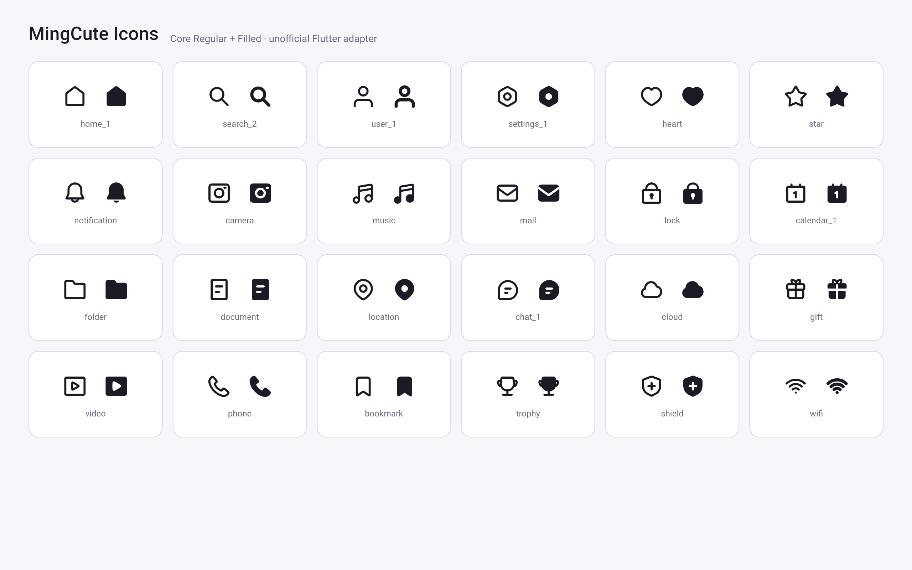
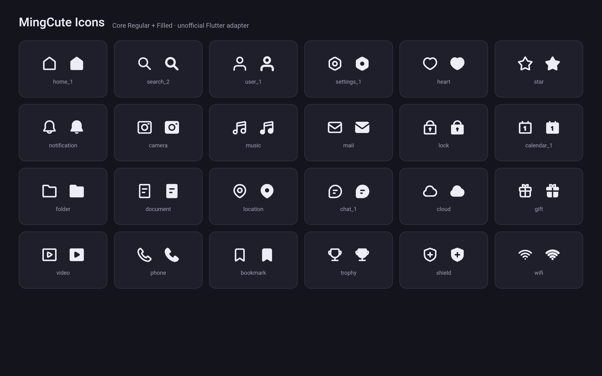
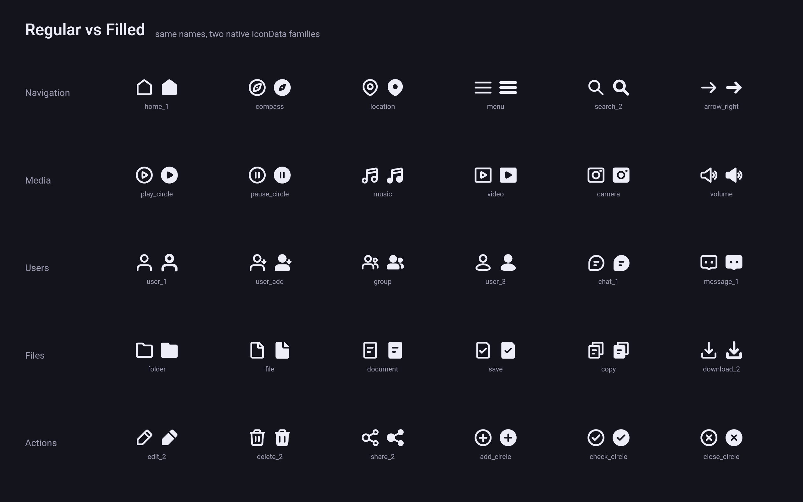

# MingCute Icons for Flutter

<!-- BEGIN MINGCUTE BADGES -->
[](https://github.com/Bruno0416/mingcute-flutter/blob/main/pubspec.yaml)
[](https://github.com/Bruno0416/mingcute-flutter/actions/workflows/ci.yml)
[](doc/ICONS.md)
[](https://github.com/mingcute-design/mingcute-icons/commit/9dc7d3ad074fb16477096a6a8109a6467d0e2fe3)
[](https://github.com/mingcute-design/mingcute-icons/blob/main/release.json)
[](https://github.com/mingcute-design/mingcute-icons)
[](https://www.mingcute.com/)
[](LICENSE)
[](UPSTREAM_APACHE_LICENSE.txt)
<!-- END MINGCUTE BADGES -->

[](https://github.com/mingcute-design/mingcute-icons)

> **Unofficial Flutter package**
>
> An independent, community-maintained adapter. Not affiliated with, maintained
> by, or endorsed by MingCute Design. Original artwork © MingCute Design,
> licensed under Apache 2.0. The banner identifies the original project.

MingCute Core Regular and Filled as native Flutter `IconData`, backed by two
bundled TrueType fonts. Use standard `Icon`, `IconButton` and `IconTheme` widgets;
no SVG runtime or custom rendering widget is required.

## Installation

Add MingCute Icons to your Flutter project:

```bash
flutter pub add mingcute_icons
```

Or add the dependency directly to `pubspec.yaml`:

```yaml
dependencies:
  mingcute_icons: ^0.1.0
```

## Quick start

### Principal API — Recommended for convenience

```dart
import 'package:flutter/material.dart';
import 'package:mingcute_icons/mingcute_icons.dart';

class Example extends StatelessWidget {
  const Example({super.key});

  @override
  Widget build(BuildContext context) => Row(
    children: [
      Icon(MingCute.regular.home_1),
      Icon(MingCute.filled.home_1),
      Icon(MingCute.regular.search_2, size: 32, color: Colors.teal),
      Icon(MingCute.filled.heart),
    ],
  );
}
```

Choose `MingCute.regular` for outlines and `MingCute.filled` for solid shapes.
Both namespaces expose the same icon names with autocomplete. Getters reuse
constant `IconData` objects, but getter expressions are **not** compile-time
constants: write `Icon(...)`, not `const Icon(...)`. See [the API guide](doc/ICONS.md).

### Static API — Recommended for optimized release size

```dart
import 'package:flutter/material.dart';
import 'package:mingcute_icons/mingcute_static.dart';

const home = Icon(MingCuteRegularConst.home_1);
const heart = Icon(MingCuteFilledConst.heart);
```

This independent library exposes the same 2,263 names per style as static
constants, compatible with Flutter's verified font tree shaker. No consumer-side
generator is needed. For optimized size, import **only** `mingcute_static.dart`:
using the getter API alongside it retained all glyphs in the tested mixed app.

## Screenshots and preview

<p>
  
  
</p>



The development gallery supports search, Regular/Filled comparison, variable
sizes, alignment guides and copying Dart usage. Run `flutter pub get` then
`flutter run -d linux` or `flutter run -d chrome` inside `preview/`.
[Preview and screenshot guide →](doc/PREVIEW.md)

## Features and catalogue

- Two native font families; size, colour and accessibility come from Flutter.
- Upstream names normalised to snake_case: `home-1` becomes `home_1`. Numeric
  suffixes are preserved; reserved words and leading digits receive `icon_`.
- Append-only codepoints, incremental generation and isolated rebuild checks.
- Only the public Core Regular and Filled artwork; no premium assets included.

## Upstream synchronization

<!-- BEGIN MINGCUTE STATUS -->
| Component | Version / status |
|---|---|
| Flutter wrapper (source, not publication status) | 0.1.0 |
| MingCute synced | 3.1.0 |
| MingCute latest declared on main | [3.1.0](https://raw.githubusercontent.com/mingcute-design/mingcute-icons/9dc7d3ad074fb16477096a6a8109a6467d0e2fe3/release.json) (last checked `9dc7d3a`) |
| Synced revision | [9dc7d3a](https://github.com/mingcute-design/mingcute-icons/commit/9dc7d3ad074fb16477096a6a8109a6467d0e2fe3) |
| Upstream comparison | In sync at the last observation |

| Catalogue | Count |
|---|---|
| Regular icons | 2,263 |
| Filled icons | 2,263 |
| Total glyphs | 4,526 |
<!-- END MINGCUTE STATUS -->

Wrapper and upstream versions belong to **different projects**. Only the synced
and latest MingCute versions are compared. “Latest” means the coordinated
version declared in upstream `release.json` on `main`, not an inferred npm
package version, Git tag or GitHub Release. The badge is live; the table records
the last verified Git observation and may lag behind it.

The scheduled sync proposes a review PR; it does not publish this package.
[Generation, provenance and badge maintenance →](doc/GENERATOR.md)

## Generator and maintenance

```bash
python -m venv .venv
. .venv/bin/activate
python -m pip install -r tool/requirements.txt
python tool/sync_icons.py --min-icons 2200
python tool/validate.py --min-icons 2200
python tool/verify_rebuild.py
bash tool/check.sh
```

Generated Dart, font families, catalogue and provenance are maintained from the
official Git source. Codepoints are never reassigned, including removed names.
Contributions should include regression tests and retain upstream attribution.
See [CONTRIBUTING.md](CONTRIBUTING.md).

## Documentation

[Getting started](doc/GETTING_STARTED.md) · [Icons and API](doc/ICONS.md) ·
[Generator](doc/GENERATOR.md) · [Preview](doc/PREVIEW.md) ·
[Release gates](doc/RELEASE.md) · [Documentation index](doc/README.md)

## Compatibility and limitations

Declared constraints: Dart `>=3.5.0 <4.0.0`, Flutter `>=3.24.0`. Current local
validation uses Flutter 3.47.9 / Dart 3.13.7. Latest/lowest dependency resolutions
do not prove every SDK version or platform; details are in [release validation](doc/RELEASE.md).

**Getter API limitation:** a small release consumer retains all 2,263 glyphs per
font on the verified SDK. The independent static API reduces each font to the
two icons used by its test app (920 / 852 bytes). CI separately requires the
principal functional contract and actual static subsetting. Mixed use retains
all glyphs. See [consumer evidence and API choices](doc/ICONS.md).

Icon fonts are monochrome. Gradients and partial opacity are flattened;
unsupported SVG features are rejected. Approximation notes are recorded in
`tool/manifest.json`. Tiny-size rendering may differ from the original SVG.

## Credits and licensing

Original icons and the unchanged official banner are by **MingCute Design and
contributors**, under [Apache-2.0](UPSTREAM_APACHE_LICENSE.txt). The banner is
not this wrapper's logo, and no trademark rights or endorsement are claimed.
Its source, commit and hash are recorded in
[banner attribution](doc/assets/branding/ATTRIBUTION.json).

Original wrapper code, tooling and documentation: [MIT](LICENSE). Derived fonts
and generated Dart/catalogue files: Apache-2.0. See
[THIRD_PARTY_NOTICES.md](THIRD_PARTY_NOTICES.md) for transformation and licence scope.

[Original repository](https://github.com/mingcute-design/mingcute-icons) ·
[Official website](https://www.mingcute.com/)
